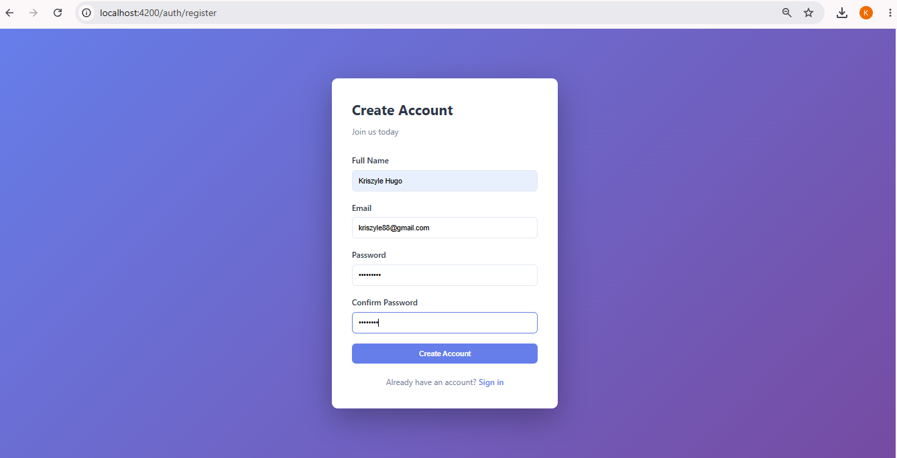
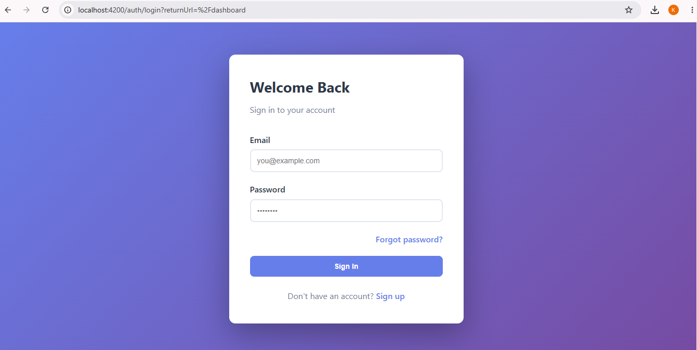
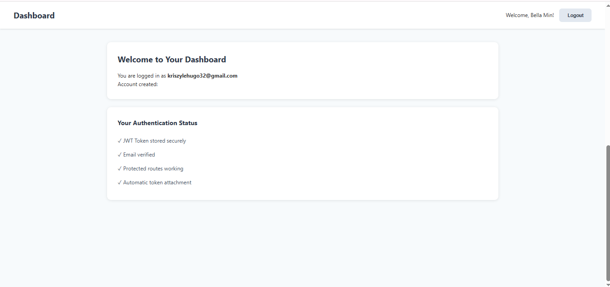
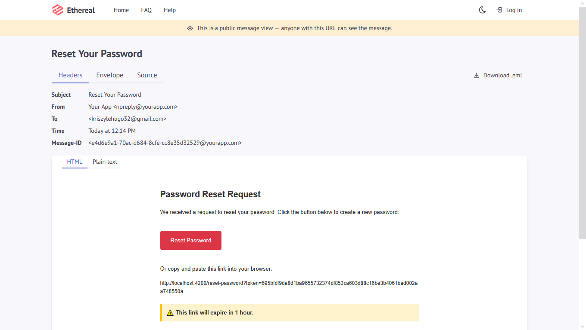
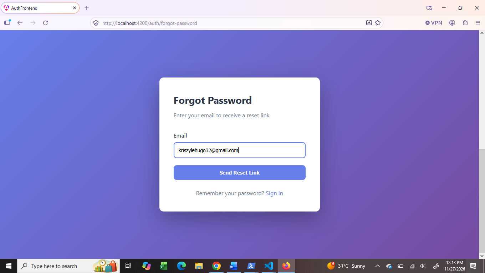
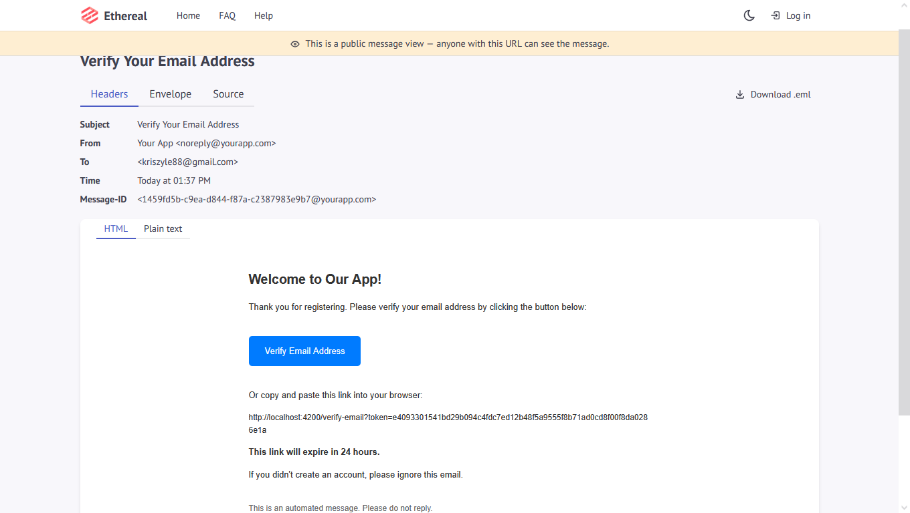

Angular 21 Authentication Frontend (`auth-frontend`)

A modern, standalone-component-based Angular 21 single-page application (SPA) implementing a complete end-to-end authentication system integrated with a Node.js/Express REST API backend (`http://localhost:3000/api`).

Features
- User Registration & Login. Reactive Forms with client-side validation (required fields, email format, password rules, and password confirmation matching).
- Email Verification. Token-based email verification page with loading, success, and error states using Angular's @switch control flow.
- Password Recovery. Complete Forgot Password and Reset Password flows using query-parameter reset tokens.
- Protected Dashboard. Displays logged-in user details name, email, createdAt, authentication status checks, and logout functionality.
- Signals-Based State Management. Centralized AuthService using signal() and computed() for reactive authentication, loading, and error states, persisted in localStorage.
- HTTP Interceptors. Functional authInterceptor attaches Authorization: Bearer <token> and errorInterceptor handles 401 Unauthorized and 403 Forbidden` responses.
- Route Guards & Lazy Loading. Functional authGuard and guestGuard protecting routes alongside lazy-loaded standalone feature components.

Verified End-to-End Flows
- Registration sends verification email
- Email verification works
- Login works after verification
- Forgot password sends reset email
- Password reset works
- Protected routes redirect to login
- Dashboard shows user data

Tech Stack
- Framework. Angular 21 (Standalone Components, Signals, Built-in Control Flow `@if` / `@switch`)
- Forms & Routing. Angular Reactive Forms, Angular Router (Lazy Loading + Functional Guards)
- HTTP & Reactivity. HttpClient  with Functional Interceptors, RxJS Observable, tap, map, catchError
- Styling: Custom responsive CSS (`src/styles.css`)
- Backend Integration. Node.js REST API (`http://localhost:3000/api`) with Ethereal email previews

Project Structure
src/
├── app/
│   ├── core/
│   │   ├── guards/
│   │   │   ├── auth.guard.ts
│   │   │   └── guest.guard.ts
│   │   ├── interceptors/
│   │   │   ├── auth.interceptor.ts
│   │   │   └── error.interceptor.ts
│   │   └── services/
│   │       └── auth.service.ts
│   ├── features/
│   │   ├── auth/
│   │   │   ├── forgot-password/
│   │   │   ├── login/
│   │   │   ├── register/
│   │   │   ├── reset-password/
│   │   │   └── verify-email/
│   │   └── dashboard/
│   ├── app.component.ts
│   ├── app.config.ts
│   └── app.routes.ts
├── environments/
│   ├── environment.ts
│   └── environment.prod.ts
└── styles.css

Setup & Installation Instructions
Prerequisites
- Node.js (v20 or v22 LTS)
- Angular CLI (`npm install -g @angular/cli`)
- Node.js Backend  running locally on `http://localhost:3000`

1. Start the Backend Server (Terminal 1)
Navigate to your backend project folder and start the development server:

'bash'
cd professional-boilerplate
npm run dev

Ensure the backend API is running on `http://localhost:3000/api` and CORS is configured to allow `http://localhost:4200`.

2. Install Dependencies & Run the Frontend (Terminal 2)
Clone the repository, install packages, and start the Angular development server:

 

Reflection Questions
1. What are the three main modern Angular features you used in this project? How do they improve the developer experience?
The three main features are Standalone Components, Signals, and Built-in Control Flow (`@if`, `@switch`). Standalone components mean I don't have to set up `NgModule` files anymore, Signals make tracking login and loading states much simpler, and `@if` / `@switch` are cleaner and easier to read in HTML templates than the old `*ngIf` syntax.

2. Explain the difference between Signals and RxJS. When would you use each?
Signals are used for holding and updating simple UI values right away, like `currentUser`, `isLoading`, or `error`. RxJS is used for asynchronous tasks that happen over time, such as making HTTP API requests with `HttpClient`.

3. Why is it important to have both an auth interceptor and an error interceptor?
The auth interceptor automatically adds the `Authorization: Bearer` token to outgoing requests so I don't have to manually add headers every time I call the backend. The error interceptor catches errors in one place—for example, if a `401` error happens, it logs the user out and redirects them to the login page.

4. How do route guards improve security and user experience?
`authGuard` stops unauthenticated users from opening protected pages like `/dashboard` and sends them to `/auth/login` instead (while remembering the page they wanted to visit). `guestGuard` keeps already logged-in users from going back to the login or register pages by redirecting them straight to `/dashboard`.

5. What is lazy loading and why is it important for performance?
Lazy loading (`loadComponent`) only downloads a page's code when the user actually visits that route instead of loading everything at once. This makes the initial page load faster because the browser downloads less JavaScript at startup.

6. Explain the "single source of truth" principle in the context of your `AuthService`.
`AuthService` stores the user and token signals in one central place. Whenever any component, guard, or interceptor needs to check if a user is logged in or get user details, it reads from `AuthService`, so the data stays consistent everywhere in the app.

7. What challenges did you face when connecting the Angular frontend to the Node.js backend? How did you solve them?
One challenge was making sure the frontend (`localhost:4200`) could talk to the backend (`localhost:3000`) without getting blocked by CORS errors, which was solved by enabling CORS on the backend. Another was making sure the TypeScript interfaces in `AuthService` matched the exact JSON response format (`success`, `data`, `error`) sent by the backend.

8. If you had to add a new feature (e.g., user profile editing), how would you approach it using the patterns you learned?
I would create a new standalone component under `src/app/features/` with a Reactive Form, add an update method in `AuthService` using `HttpClient` to call the backend endpoint and update `currentUserSignal`, and add a lazy-loaded route in `app.routes.ts` protected by `authGuard`.

9. What security considerations did you implement in the frontend (token storage, XSS prevention, etc.)?
I stored the JWT token in `localStorage` so it persists on refresh, cleared it immediately on logout or `401` errors, used `authGuard` to protect private routes, added form validation rules, and relied on Angular's built-in template escaping (`{{ }}`) to help prevent XSS attacks.

10. How does this Angular frontend demonstrate the "Integrative Programming" concepts from this course?
It connects two separate applications—an Angular frontend on port `4200` and a Node.js/Express backend on port `3000`—so they work together as one full-stack system using REST API endpoints, JSON data formats, and JWT authentication.